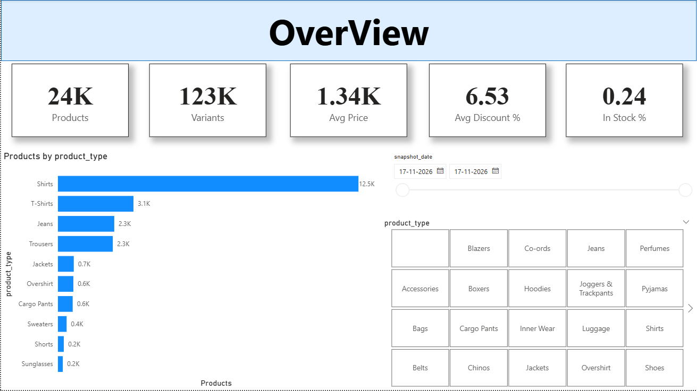
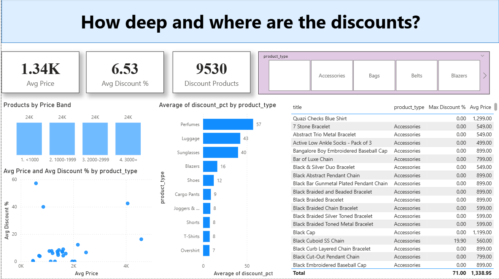
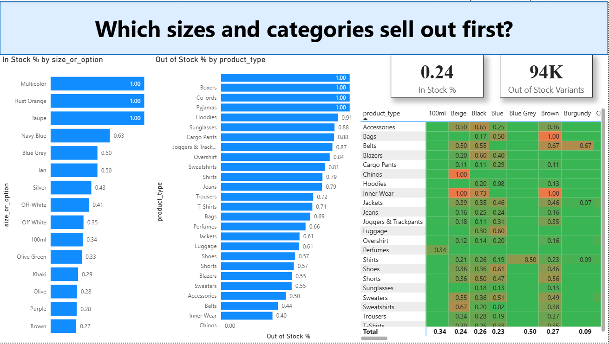
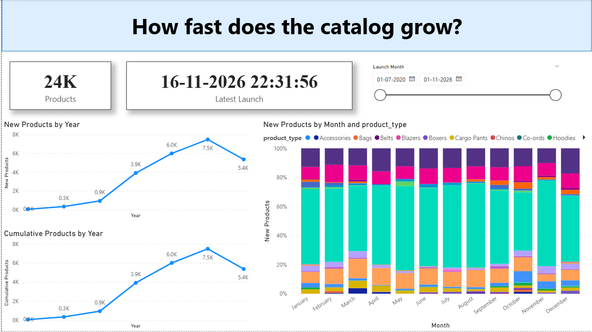
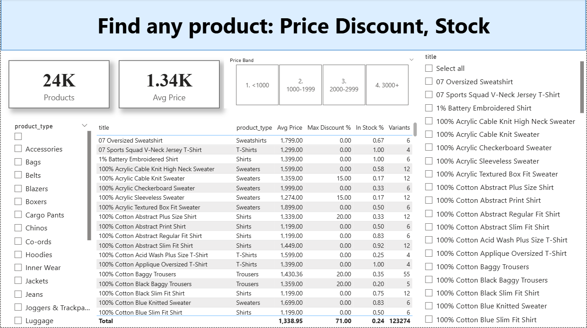

# Snitch E-commerce Analytics Pipeline

End-to-end data analytics project on **real, scraped e-commerce data**: Python extraction → AWS S3 data lake → PostgreSQL (raw / staging / mart) → Power BI dashboard.

## Project Overview

Instead of using a ready-made dataset, I scraped the public product catalog of [Snitch](https://snitch.co.in) (an Indian fashion brand) and built a full pipeline around it. The result is a **24,095-product** analytical dataset covering pricing, discounts, size-level stock availability, and catalog growth.

## Architecture

```
Snitch /products.json
        │  (Python: requests, pagination, retry/backoff)
        ▼
   AWS S3  ── raw JSON, partitioned by store/date
        │  (Python: boto3 + psycopg2)
        ▼
 PostgreSQL ── raw (jsonb) → staging (flattened view) → mart (star schema)
        │
        ▼
    Power BI ── 5-page interactive dashboard
```

## Tech Stack

| Layer | Tools |
|---|---|
| Extraction | Python, requests |
| Storage (raw) | AWS S3, IAM (least-privilege user), boto3 |
| Warehouse | PostgreSQL (jsonb, CTEs, window functions) |
| Modeling | Star schema: `dim_product`, `fact_variant_snapshot` |
| BI | Power BI, DAX |

## Data Model

- `raw.products_raw`: untouched JSON per product (`jsonb`), with source file and load timestamp
- `staging.stg_variants`: view that flattens products into one row per variant
- `mart.dim_product`: one row per product (title, vendor, type, launch date)
- `mart.fact_variant_snapshot`: one row per variant per snapshot date (price, compare-at price, availability, discount %)

The fact table is snapshot-based, so running the pipeline daily builds a price history.

## Dashboard

### 1. Overview


### 2. Pricing & Discounts


### 3. Availability


### 4. Catalog Growth


### 5. Product Explorer


## Key Insights

- **Catalog size:** 24,095 unique products and XX,XXX variants (size/colour combinations)
- **Pricing:** average price is ₹XXXX; most products fall in the ₹XXXX–₹XXXX band
- **Discounts:** XX% of products carry a discount, averaging XX% off; deepest discounts are in **[category]**
- **Availability:** overall in-stock rate is XX%; sizes **[size]** and **[size]** run out first
- **Growth:** the catalog added the most products in **[month/year]**; **[category]** dominates new launches

## Project Structure

```
├── scraper/
│   ├── extract_to_s3.py       # scrape Snitch -> S3
│   └── load_to_postgres.py    # S3 -> Postgres raw table
├── sql/
│   ├── 00_checks.sql
│   ├── 01_staging.sql
│   ├── 02_mart.sql
│   └── 03_analysis.sql
├── powerbi/
│   └── snitch_dashboard.pbix
├── docs/                      # dashboard screenshots
├── .env.example
├── requirements.txt
└── README.md
```

## How to Run

**Prerequisites:** Python 3.9+, PostgreSQL, an AWS account with an S3 bucket and an IAM user, Power BI Desktop.

1. Install dependencies
   ```bash
   pip install -r requirements.txt
   ```
2. Configure AWS credentials (`aws configure`, using an IAM user, not root) and set your bucket name in `scraper/extract_to_s3.py`
3. Create a Postgres database `ecom_db`, then copy `.env.example` to `.env` and set `PG_PASSWORD`
4. Run the pipeline from the project root
   ```bash
   python scraper/extract_to_s3.py
   python scraper/load_to_postgres.py
   ```
5. Run the SQL files in `sql/` in order (`01` → `02` → `03`) in pgAdmin, connected to `ecom_db`
6. Open `powerbi/snitch_dashboard.pbix` and point it at your Postgres instance

## Engineering Notes

- Pagination stops when a page returns no new product IDs (protects against stores that repeat pages)
- Retry with backoff on HTTP 429; 2s delay between requests
- The loader is idempotent: it skips S3 files already loaded
- Raw JSON is kept untouched in S3 and Postgres, so the model can be rebuilt any time
- Secrets are kept in `.env` / AWS config and excluded from git

## Future Work

- Daily scheduling (Task Scheduler / GitHub Actions) to build price-change history
- Window-function analysis of price changes across snapshots (`LAG`)
- Snowflake + S3 storage integration as an alternative warehouse
- Incremental mart loads instead of full rebuilds

## Disclaimer

Data comes from Snitch's publicly available product feed, collected at a low request rate for educational and portfolio purposes only. No personal data is collected, and all product data belongs to its respective owner.